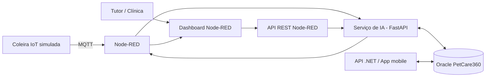

# PetCare360 — Sprint 4 (Disruptive Architectures: IoT, IoB & Generative IA)

Solução de acompanhamento contínuo da saúde de pets para a **CLYVO VET**. Uma coleira (simulada) envia telemetria por MQTT, o Node-RED expõe uma API REST e um dashboard, e um serviço de IA em Python classifica a prioridade de cada leitura, calcula o **IRP (Índice de Risco/Prioridade)**, personaliza a recomendação com os dados do pet no Oracle e compara a leitura com o histórico do próprio animal.

O serviço usa o **mesmo banco Oracle da API .NET e do app mobile do PetCare360**: lê pets e medicamentos das tabelas que o app já alimenta e grava cada análise da IA ligada ao pet.

> Protótipo acadêmico. O modelo é treinado com dados sintéticos e **não substitui avaliação de um médico-veterinário**.

## Integrantes — 2TDSPW

| Nome | RM |
|---|---|
| João Vitor Lacerda | RM565565 |
| Kauan Vieira de Lima | RM565403 |
| Murillo Fernandes Carapia | RM564969 |
| Pedro de Matos Previtali | RM564184 |

## Links

- Vídeo pitch (YouTube, não listado): _adicionar link_
- Repositório: _adicionar link_

## Problema e solução de IA

Entre uma consulta e outra, o tutor não tem como saber se uma mudança de comportamento, apetite ou temperatura do pet merece atenção. A clínica, por sua vez, não sabe quais pacientes priorizar.

A IA do PetCare360 resolve isso em quatro etapas a cada leitura:

1. **Classificação** com `RandomForestClassifier` em três níveis: `NORMAL`, `ATENÇÃO` e `ALTO`.
2. **IRP de 0 a 10**, derivado das probabilidades do modelo, para ordenar e visualizar a prioridade.
3. **Personalização**: espécie e idade do pet (de `TB_PET`) entram no modelo, e os medicamentos em uso (de `TB_MEDICAMENTO`) entram na recomendação.
4. **Acompanhamento contínuo**: cada análise é gravada em `TB_ANALISE_IA` e comparada com as últimas análises do mesmo pet, indicando piora, melhora ou estabilidade.

Detalhes do modelo, dados e fórmulas em [`docs/COMPONENTE_IA.md`](docs/COMPONENTE_IA.md).

## Arquitetura



Fluxo completo, tabelas e variáveis de ambiente em [`docs/ARQUITETURA.md`](docs/ARQUITETURA.md).

## Tecnologias

- Python 3.10+, FastAPI, Uvicorn
- scikit-learn (Random Forest), NumPy
- Oracle Database (`python-oracledb`), com SQLite local como alternativa
- Node-RED, `node-red-dashboard`, MQTT (HiveMQ público)
- unittest + FastAPI TestClient

## Estrutura do repositório

```
PetCare360_Sprint4/
├── ai_service/
│   ├── main.py              API FastAPI (endpoints)
│   ├── modelo.py            Random Forest, IRP, acelerômetro, faixa etária
│   ├── personalizacao.py    motivos, tendência e recomendação personalizada
│   ├── repositorio.py       acesso ao Oracle (TB_PET, TB_MEDICAMENTO, TB_ANALISE_IA)
│   ├── requirements.txt
│   └── .env.example
├── nodered/
│   └── PetCare360_Sprint4.json
├── sql/
│   └── analise_ia_sprint4.sql
├── tests/
│   ├── test_api.py
│   └── test_modelo.py
├── docs/
│   ├── ARQUITETURA.md
│   ├── COMPONENTE_IA.md
│   ├── ROTEIRO_PITCH.md
│   └── evidencias/
└── README.md
```

## Como executar

### 1. Banco de dados

O projeto usa o schema Oracle do PetCare360 já criado pelas migrations da API .NET (`TB_TUTOR`, `TB_PET`, `TB_MEDICAMENTO`, `TB_CONSULTA`, `TB_VACINA`...). Nenhuma tabela existente é alterada.

No SQL Developer, execute apenas `sql/analise_ia_sprint4.sql` (F5). Ele:

- cria a tabela `TB_ANALISE_IA`, com FK para `TB_PET`;
- cadastra um medicamento contínuo ativo para o pet Thor (ID 61) em `TB_MEDICAMENTO`;
- insere 5 análises anteriores do Thor para demonstrar o acompanhamento contínuo.

### 2. Serviço de IA

Na raiz do projeto:

```bash
python -m venv .venv
.venv\Scripts\Activate.ps1
pip install -r ai_service/requirements.txt
copy ai_service\.env.example ai_service\.env
uvicorn ai_service.main:app --host 127.0.0.1 --port 8000
```

No Linux/macOS use `source .venv/bin/activate` e `cp`. Antes de subir, preencha `ai_service/.env` com usuário, senha e DSN do Oracle.

Confira em `http://127.0.0.1:8000/health` (o campo `persistencia` deve mostrar `oracle`) e use a documentação interativa em `http://127.0.0.1:8000/docs`.

### 3. Node-RED

1. Instale o Node-RED (`npm install -g --unsafe-perm node-red`) e rode `node-red`.
2. Instale o `node-red-dashboard` (Menu → Manage palette → Install).
3. Menu → Import → selecione `nodered/PetCare360_Sprint4.json` → Deploy.
4. Abra o dashboard em `http://127.0.0.1:1880/ui`.

### 4. Usando o dashboard

- **Simulador IoT**: os botões Normal, Atenção e Alto publicam uma leitura da coleira do Thor no MQTT, com 50 amostras do acelerômetro.
- **Avaliação manual**: o formulário envia os dados de qualquer pet para a API REST do Node-RED.
- **Análise da IA**: classificação, IRP, recomendação personalizada, motivos, medicamentos ativos do Oracle e alerta.
- **Acompanhamento contínuo**: tendência do pet e gráfico do IRP ao longo do tempo; o seletor carrega o histórico de qualquer pet cadastrado.

## API

| Método | Rota | Serviço | Descrição |
|---|---|---|---|
| POST | `/api/ia/analisar` | Node-RED :1880 | Porta de entrada da aplicação; encaminha para a IA e devolve a análise |
| POST | `/api/ia/analisar` | IA :8000 | Classifica, calcula o IRP, personaliza e grava a análise |
| GET | `/api/ia/pets/{id}/historico` | IA :8000 | Histórico de análises e resumo do pet |
| GET | `/api/ia/modelo` | IA :8000 | Métricas, matriz de confusão e importância das features |
| GET | `/health` | IA :8000 | Status do serviço e banco em uso |

Exemplo:

```bash
curl -X POST http://127.0.0.1:1880/api/ia/analisar \
  -H "Content-Type: application/json" \
  -d '{"petId":61,"temperatura":39.8,"umidade":72,"atividade":20,"alimentacao":35,"comportamento":"Alterado"}'
```

Resposta resumida:

```json
{
  "idAnalise": 6,
  "persistencia": "oracle",
  "nome": "Thor",
  "perfil": { "especie": "Cão", "raca": "Golden Retriever", "idade": 4, "faixaEtaria": "adulto", "fonte": "banco" },
  "telemetria": { "temperatura": 39.8, "atividade": 20, "origemAtividade": "informada" },
  "analiseIA": {
    "nivel": "ALTO",
    "irp": 10,
    "probabilidades": { "NORMAL": 0.0, "ATENÇÃO": 0.013, "ALTO": 0.987 },
    "motivos": ["Temperatura bem acima da faixa de referência usada no protótipo", "..."],
    "recomendacoesPersonalizadas": ["Há medicamento em uso registrado (Condroprotetor): ..."],
    "medicamentosAtivos": ["Condroprotetor"],
    "tendencia": { "status": "PIORA", "variacoes": { "temperatura": 1.36, "atividade": -55.6 } }
  }
}
```

Em vez de `atividade`, a requisição pode trazer `acelerometro` com amostras `[x, y, z]` em g; o índice de atividade é calculado pelo serviço.

## Testes

```bash
python -m unittest discover -s tests -v
```

São 21 testes cobrindo fórmula do IRP, cálculo de atividade pelo acelerômetro, faixa etária, métricas mínimas do modelo, detecção de tendência, os três cenários de uso pela API, validação de entrada, personalização para pet idoso e persistência com histórico. Os testes usam um SQLite temporário e não alteram o Oracle.

## Resultados

Métricas do Random Forest sobre a base sintética (600 amostras de teste):

| Métrica | Valor |
|---|---|
| Acurácia (teste) | 0,898 |
| Validação cruzada 5 folds | 0,893 ± 0,014 |
| F1 NORMAL / ATENÇÃO / ALTO | 0,906 / 0,878 / 0,918 |

Importância das features: temperatura 0,36 · alimentação 0,29 · atividade 0,26 · faixa etária 0,06 · comportamento 0,04.

Cenários de uso validados com o Thor (ID 61, cão adulto):

| Cenário | Temperatura | Atividade | Alimentação | Comportamento | Nível | IRP |
|---|---|---|---|---|---|---|
| Normal | 38,3 °C | 78 | 90 | Normal | NORMAL | 0 |
| Atenção | 39,3 °C | 40 | 50 | Alterado | ATENÇÃO | 6 |
| Alto | 39,8 °C | 20 | 35 | Alterado | ALTO | 10 |

Evidências do dashboard, da API e do banco estão em [`docs/evidencias`](docs/evidencias).

## Limitações

- A base de treino é sintética, gerada a partir de regras de triagem simplificadas com ruído de sensor. Não há validação com animais reais.
- A calibração do acelerômetro (0,02–0,60 g → 0–100) é demonstrativa e precisa ser ajustada para o hardware real.
- Limites e recomendações precisam de revisão de um médico-veterinário antes de uso real.