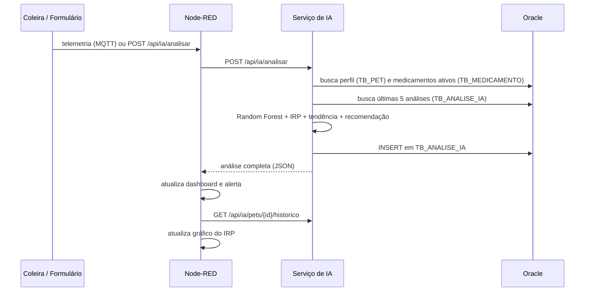

# Arquitetura — PetCare360 Sprint 4

## Componentes

| Componente | Tecnologia | Papel |
|---|---|---|
| Coleira IoT | Simulador no Node-RED | Publica temperatura, umidade, alimentação, comportamento e amostras do acelerômetro no tópico `petcare360/sprint4/telemetria` |
| Broker | MQTT (HiveMQ público) | Transporta a telemetria |
| Node-RED | Fluxo `nodered/PetCare360_Sprint4.json` | Recebe MQTT, expõe a API REST `/api/ia/analisar`, chama a IA e atualiza o dashboard |
| Dashboard | `node-red-dashboard` | Interface do tutor/clínica: formulário, simulador, sinais, análise e histórico |
| Serviço de IA | FastAPI (`ai_service`) | Random Forest, IRP, personalização, tendência e persistência |
| Banco | Oracle do PetCare360 | Mesmo schema usado pela API .NET e pelo app mobile |

## Fluxo de uma análise

## Banco de dados

O serviço reutiliza o schema Oracle do PetCare360, criado pelas migrations da API .NET. Assim, um pet cadastrado pelo app mobile é analisado pela IA com os mesmos dados, e um medicamento registrado pela API aparece na recomendação.

| Tabela | Origem | Uso pela IA |
|---|---|---|
| `TB_PET` | API .NET | Leitura de nome, espécie, raça, peso e idade (calculada por `DT_NASCIMENTO`) |
| `TB_MEDICAMENTO` | API .NET | Leitura dos medicamentos com `DT_INICIO <= hoje` e `DT_FIM` nula ou futura |
| `TB_ANALISE_IA` | Sprint 4 | Gravação de cada análise e leitura do histórico |

`TB_ANALISE_IA` é a única tabela nova (`sql/analise_ia_sprint4.sql`). Guarda a telemetria usada, nível, IRP, probabilidades de cada classe e origem da leitura (`coleira-mqtt`, `dashboard`, `api`), com FK para `TB_PET` (`ON DELETE CASCADE`) e índice por `(ID_PET, DT_ANALISE)` para as consultas de histórico. Nenhuma tabela existente é alterada, e as migrations da API .NET continuam funcionando normalmente.

Carga de demonstração: o medicamento contínuo "Condroprotetor" e cinco análises anteriores para o pet Thor (ID 61).

## Variáveis de ambiente

| Variável | Onde | Padrão |
|---|---|---|
| `ORACLE_USER`, `ORACLE_PASSWORD`, `ORACLE_DSN` | `ai_service/.env` | não definidas (usa SQLite local) |
| `PETCARE360_SQLITE` | `ai_service/.env` | `dados/petcare360.db` |
| `PETCARE360_AI_BASE_URL` | ambiente do Node-RED | `http://127.0.0.1:8000` |
| `PETCARE360_API_URL` | ambiente do Node-RED | `http://127.0.0.1:1880/api/ia/analisar` |

Credenciais nunca vão para o repositório: `.env` está no `.gitignore` e só o `.env.example` é versionado. Sem as variáveis do Oracle, o serviço funciona com SQLite local, mas sem perfil e medicamentos vindos do banco.

## Tratamento de erros

- Entrada inválida (temperatura fora de 25–45 °C, percentuais fora de 0–100, menos de 3 amostras de acelerômetro, sem atividade) retorna `422` com a mensagem do problema.
- Se o serviço de IA estiver fora do ar, a API do Node-RED responde `502` e o dashboard não é atualizado com dados inválidos.
- Falhas no Oracle são registradas no log do serviço; a análise é devolvida mesmo assim, com `idAnalise: null`.